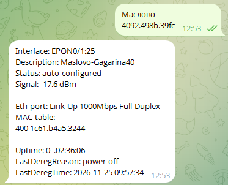

# Описание

Бот получает имя OLT (hostname, location) и MAC-адрес ONU и выводит информацию о его состоянии:

- Номер интерфейса
- Описание, если оно указано
- Статус
- Оптический сигнал (RX)
- Состояние Ethernet-порта
- Таблицу MAC-адресов в формате: VLANID MAC
- Uptime
- Причина последнего отключения
- Время последнего отключения




# Установка и использование

- На **хосте**, на котором будет запущен бот, должны быть доступны сеть управления OLT-ами и api.telegram.org (149.154.160.0/20).
- В файле **.env** указать токен Telegram-бота и параметры доступа на OLT (пример .env.example).
- В файле **IP-devices.xlsx** указать идентификаторы, по которым бот будет искать OLT и его IP-адрес (пример IP-devices.xlsx.example).
- Для создания образа, в корне проекта выполнить команду:

```bash
docker build -t bdcom-helper-bot -f Docker/Dockerfile . 
```

- Для запуска Docker-контейнера, в корне проекта выполнить команду:

```bash
docker run -d --restart unless-stopped --name bdcom-helper-bot --env-file .env \
-v ./IP-devices.xlsx:/usr/src/app/IP-devices.xlsx bdcom-helper-bot
```
